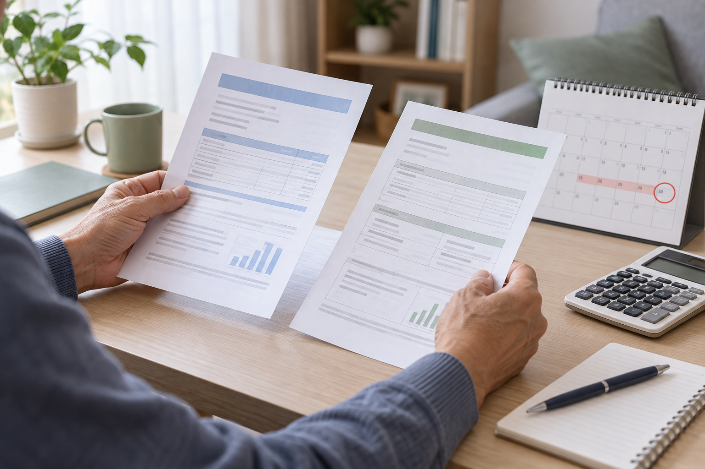

*이 그림에서 볼 부분은 환급금 자체보다 안내문 주소와 신청 계좌를 대조하는 순서다.*

2026년 본인부담상한액 초과금 안내문을 못 받았거나 “주소 불명”으로 반송됐다면, 우편을 기다리지 말고 국민건강보험공단에서 환급 대상과 계좌 상태를 확인해야 한다. 본인 계좌가 가능하면 온라인 조회가 가장 빠르다. 비급여·상급병실료·임플란트 등은 계산에서 빠질 수 있다.

## 안내문 반송이 곧 환급 대상 제외는 아니다

공단은 대상자에게 안내문과 신청서를 보내지만, 이사·장기 부재·주소 오류가 있으면 반송될 수 있다. 공시송달 게시판에도 **2026년 10월 30일** 기준 해당 반송 건이 올라와 있다. 반송됐다고 대상에서 빠진 것은 아니므로 환급금 조회 화면에서 본인 명의 신청 가능 여부를 확인한다.

| 확인 상황 | 먼저 할 일 | 준비할 자료 |
|---|---|---|
| 상황 | 확인할 것 | 자료 |
|---|---|---|
| 안내문을 못 받음 | 홈페이지·The건강보험 앱 조회 | 본인 인증, 본인 계좌 |
| 이사 뒤 반송 | 공단 주소와 현재 주소 대조 | 신분증, 연락처 |
| 환자가 직접 신청하기 어려움 | 지사에 대리 신청 요건 문의 | 가족관계증명서·위임장·진단서 등 |

## 온라인에서 확인하는 순서

1. 공단에 로그인해 `민원신청 → 미지급환급금 통합조회 및 신청`으로 들어간다.
2. `본인부담상한액 초과금`에서 대상, 신청 여부, 등록 계좌를 확인한다.
3. 대상 내역이 없으면 관할 지사나 **1577-1000**에 반송 건과 진료연도를 문의한다.

판정 기준은 **건강보험이 적용된 본인일부부담금이 개인별 상한액을 넘었는가**다. 비급여, 전액본인부담, 선별급여, 임플란트, 2·3인실 상급병실료 등은 제외될 수 있다.

## 반려되거나 계좌가 막힐 때

가족 계좌로 받으려면 환자의 상태와 관계에 따라 위임장, 가족관계증명서, 진단서가 필요할 수 있다. 가족이라는 이유만으로 계좌만 바꾸면 보완 요청을 받을 수 있으니 본인 계좌 가능 여부부터 묻는 편이 낫다.

반려되면 다음 세 가지를 적어 문의한다.

- 환자 이름과 진료연도
- 반려 또는 보완 문구 그대로
- 본인 계좌인지, 대리·가족 계좌인지

주소 변경과 계좌 수령 문제는 나눠 문의한다.

## 신청 전 체크리스트

- [ ] 공단 홈페이지 또는 The건강보험 앱에서 초과금을 조회했다.
- [ ] 공단에 등록된 주소·휴대전화가 현재 정보와 같다.
- [ ] 본인 계좌 예금주가 환자 본인인지 확인했다.
- [ ] 비급여 진료비를 환급 예상액에 포함하지 않았다.
- [ ] 가족 계좌라면 추가 서류를 지사에 먼저 물었다.
- [ ] 반려 문구와 문의 날짜·담당 부서를 기록했다.

2026년 11월 1일 기준 최종 판단은 공단의 개인별 산정과 신청 상태다. 공식 안내는 [국민건강보험공단 본인부담액상한제](https://www.nhis.or.kr/static/html/wbma/c/wbmac0209.html), 온라인 메뉴는 [공단 사이버민원 이용 안내](https://www.nhis.or.kr/static/html/wbmh/b/wbmhb0302.html), 반송 공고는 [사회보험통합징수포털 공시송달](https://si4n.nhis.or.kr/jpca/JpCad00401.do)에서 확인할 수 있다.
